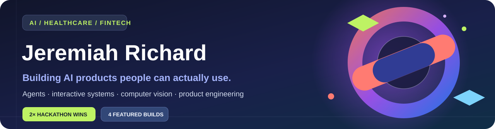
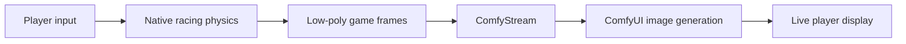

<a href="#01--moneyfinder">🏆 MoneyFinder</a> &nbsp;·&nbsp;
<a href="#02--somo">🏆 Somo</a> &nbsp;·&nbsp;
<a href="#03--rehabninja">🎮 RehabNinja</a> &nbsp;·&nbsp;
<a href="#04--comfy-race">🏎️ Comfy Race</a>

**AI Engineer · Solution Design**

I design and build AI systems from problem definition through working product—connecting models, agents, computer vision, interfaces, and infrastructure into useful experiences. My work spans healthcare, financial technology, and interactive creative tools.

**4× hackathon winner** &nbsp;·&nbsp; **4 featured builds** &nbsp;·&nbsp; **Open-source builder**

[Selected work](#selected-work) · [Currently building](#04--comfy-race) · [How I build](#how-i-build)

---

## Selected work

### 01 / MoneyFinder &nbsp; 🏆 Hackathon winner

**AI-powered opportunity discovery for small businesses.**

MoneyFinder researches a business, identifies relevant **tax credits and unclaimed-funds opportunities**, creates an evidence-backed dossier, and prepares claim forms. The goal is to replace hours of disconnected research and repetitive paperwork with an explainable, approval-first workflow.

[**Explore the repository ↗**](https://github.com/thetradingdoc/moneyfinder) &nbsp;·&nbsp; [**Watch the demo ↗**](https://youtu.be/ltOwx898b8c)

<b>How it works — open the build notes</b>

 

- **Research:** builds a sourced business profile using company information and public records.
- **Reasoning:** matches company characteristics to specific incentives and explains why each program might apply.
- **Agent action:** creates a form-ready dossier, fills forms using a browser agent, reads values back, and stops for human approval.
- **Evidence:** preserves provenance and separates agency claim status from actual payment confirmation.

**Stack:** Python · AI agents · AWS Bedrock / Claude · SurrealDB · Anchor Browser · Daytona · Arize.

*The demo uses synthetic business data; recommendations are not tax or legal advice.*

---

### 02 / Somo &nbsp; 🏆 Hackathon winner

**An AI-native front desk for healthcare practices.**

Somo combines a conversational **AI receptionist** with operational tools for appointment booking, insurance eligibility, patient administration, and billing. It is designed to reduce repetitive front-desk work while keeping clinical and financial workflows auditable.

[**Explore the repository ↗**](https://github.com/thetradingdoc/somo-platform) &nbsp;·&nbsp; [**Somo website ↗**](https://callsomo.com)

<b>Explore the platform — product and architecture</b>

 

- **Voice front desk:** the Kelly AI agent handles inbound conversations and appointment scheduling.
- **Practice operations:** provider workflows cover patient context, schedules, confirmations, and front-desk visibility.
- **Revenue cycle:** insurance eligibility, claim workflows, payment tools, and medical coding integrations.
- **Two product lines:** a B2B front-desk pilot and a separate consumer health-session experience.

**Stack:** JavaScript / Node.js · Retell AI · FHIR · Stedi · Stripe · Google Cloud.

*Prototype and pilot functionality should not be confused with independently validated clinical or production outcomes.*

See another Somo screen

 

---

### 03 / RehabNinja &nbsp; Completed interactive prototype

**Physical rehabilitation turned into a camera-powered game.**

RehabNinja makes home exercises feel like play. A person follows a prescribed movement in front of their phone: **good reps slice fruit; form mistakes turn into bombs**. Behind the game, pose tracking records movement quality and gives simple feedback after the session.

[**Explore the repository ↗**](https://github.com/thetradingdoc/rehabninja) &nbsp;·&nbsp; [**Demo walkthrough ↗**](https://github.com/thetradingdoc/rehabninja/blob/main/docs/PLAY-DEMO.md)

<b>What is inside the prototype?</b>

 

- **On-device computer vision:** YOLO11 pose inference with a MediaPipe fallback.
- **Real interaction:** tracks chair stands, squats, and balance exercises; game reactions correspond to movement/form events.
- **Patient experience:** short voice prompts, accessible feedback, and end-of-session summaries.
- **Safety design:** explicit symptom questions and rule-based triage, rather than AI inventing medical decisions.

**Stack:** Next.js · TypeScript · WebGPU / WASM · YOLO / MediaPipe · PixiJS · ElevenLabs.

*Built as a demo using synthetic patient data; not a clinically validated rehabilitation device.*

---

### 04 / Comfy Race &nbsp; In development

**What if ComfyUI could render the visuals of a game while you're playing it?**

Comfy Race explores a live racing experience where a native physics engine handles steering and collisions, and **ComfyStream + ComfyUI** restyle the actual game footage as it arrives. The essential proof is simple: **can you finish a race while watching only the AI-generated view?**

[**Explore the repository ↗**](https://github.com/thetradingdoc/comfy-race) &nbsp;·&nbsp; [**Read the build epic ↗**](https://github.com/thetradingdoc/comfy-race/blob/main/docs/BUILD_PLAN.md)

<b>Live system architecture — see the planned pipeline</b>

 

**Status:** design and source review completed; playable latency and the end-to-end integration have **not** been validated. No rendered demo is presented here as a finished feature.

---

## How I build

I work across the product stack, from an idea and user journey to APIs, model orchestration, real-time interaction, deployment, and testing.

<b>More open-source work</b>

 

- [Clinical Data Science Portfolio](https://github.com/thetradingdoc/ClinicalDataSciencePortfolio) — applied machine learning in healthcare.
- [ComfyUI Templates](https://github.com/thetradingdoc/awesome-comfyui-templates) — reproducible creative AI workflows.
- [Medical RAG API](https://github.com/thetradingdoc/medical-rag-api) — medical code retrieval through vector search.
- [BillOps Agent](https://github.com/thetradingdoc/billops-agent) — invoice intake, policy review, and human-approved processing.

---

**Build real things. Show the work. Keep the evidence.** &nbsp;·&nbsp; [All repositories](https://github.com/thetradingdoc?tab=repositories)
